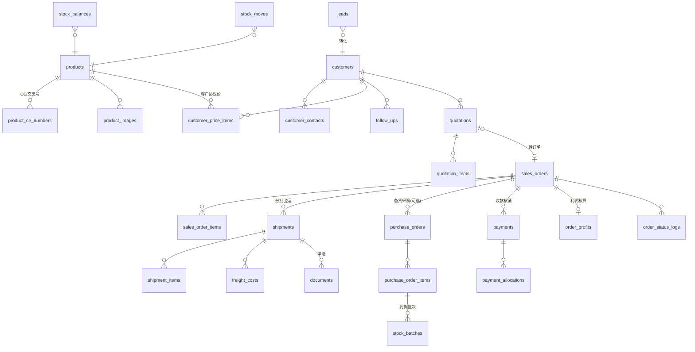
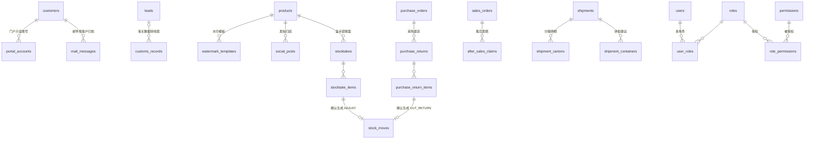

# 核心数据结构设计

- 版本：v2.1（2026-11-23，**实现回写**：按从零落地的代码校准字段、跨库类型策略与增补表，见第 14 节）
- 历史版本：v2.0（2026-11-19 交付版）、v1.0（2026-11-17）
- 数据库：PostgreSQL 16（生产）/ SQLite（开发，`DATABASE_URL` 切换）；**DDL 不做「同一份 SQL 双库直跑」的承诺**，改为 SQLAlchemy 通用类型 + `JSON/JSONB` 变体 + Alembic 迁移（见第 14 节）
- 配套方案：《ERP系统规划方案.md》v2.1（实现交付版，附录 E 为验收基线）
- 范围：产品 / CRM / 报价 / 订单（含分批）/ 采购 / 库存 / 出运单证 / 财务 / 系统 / **获客 / 门户 / 邮件** 全域核心表；标注 P0/MVP、P1、P2 与实施阶段对应

---

## 0. 通用设计规范

| 规范 | 约定 |
|---|---|
| 命名 | 表名/字段名 snake_case；主键 `id BIGINT GENERATED ALWAYS AS IDENTITY` |
| 通用字段 | 每表含 `created_at / created_by / updated_at / updated_by`；业务表含 `deleted_at`（软删除）与 `remark` |
| 金额三元组 | 所有金额字段组：`amount NUMERIC(14,2)`（原币）+ `currency CHAR(3)` + `exchange_rate NUMERIC(12,6)` + `base_amount NUMERIC(14,2)`（本位币 CNY） |
| 快照原则 | 单据行冗余 `name_snapshot / oe_snapshot / package_snapshot / unit_price / cost_snapshot`——产品改名改价不影响历史单据 |
| OE 号规范化 | 存 `oe_no`（原样）+ `oe_norm`（去空格横杠大写，用于匹配检索），表达式索引加速 |
| 状态机 | 状态字段用 TEXT + CHECK 枚举；每次流转写 `status_logs`，禁止原地篡改历史 |
| 编号 | 单据号由 `sequences` 表驱动（前缀 + 日期 + 当日流水），如 QT+YYYYMMDD+NNNN |
| 审计 | 关键表（价格/账户/状态/审批）写 `audit_logs`（before/after JSON） |

---

## 1. ER 总览（核心关系）

> 上图为 P0 核心业务关系。**v2.0 / v2.1 增补域**（获客 / 门户 / 邮件 / 分箱拼柜 / 盘点 / 采购退货 / 索赔 / 权限矩阵）关系补充如下；完整的 66 张表清单见第 14.1 节。

---

## 2. 产品域（P0，MVP 第一批）

### 2.1 products 产品主表

| 字段 | 类型 | 说明 |
|---|---|---|
| id | PK | |
| code | TEXT UNIQUE | 内部编码，如 HP-0001 |
| name_cn / name_en | TEXT | 中文名 / 英文名（客户单据用，入库时定稿） |
| category_id | FK→categories | 三级分类 |
| brand_grade | TEXT | 原厂/品牌/副厂 |
| spec_params | JSONB | 规格参数（键值自由扩展） |
| unit | TEXT | 计量单位（pcs/set/box） |
| package_type | TEXT | 包装方式选项（报价单 PACKAGE 列） |
| inner_qty / carton_qty | INT | 内盒数 / 每箱数（按箱订换算用） |
| net_weight / gross_weight / carton_volume | NUMERIC | 包装参数（装柜/单证用） |
| barcode | TEXT | 条码 |
| standard_price / currency | NUMERIC / CHAR(3) | 标准价 |
| status | TEXT CHECK | 在售 / 停售 / 待开发 |
| deleted_at | TIMESTAMPTZ | 软删除 |

### 2.2 product_oe_numbers OE 号表（多对多）

| 字段 | 类型 | 说明 |
|---|---|---|
| product_id | FK | |
| oe_no | TEXT | 原样（如 25100-03011） |
| oe_norm | TEXT | 规范化（2510003011），**索引**，匹配/搜索用 |
| oe_type | TEXT | OE / CROSS（交叉号）/ ALT（替代号） |
| is_primary | BOOL | 主 OE（报价单默认显示） |

### 2.3 其他

- **product_relations**（id, product_id, related_product_id, relation_type: ALT/SUBSTITUTE）——互换/替代推荐；
- **product_images**（id, product_id, source: LOCAL/MATERIAL, material_image_id, file_path, thumb_path, is_main, filename）——本地批量上传（文件名解析 OE 匹配）与素材库 API 同步共用；
- **watermark_templates**（id, name, owner_user_id, scope: COMPANY/PERSONAL, content_text, logo_path, position, opacity, font_size, color, is_active）——水印模板，导出/复制时非破坏性实时合成；
- **categories**（id, parent_id, name, level）——三级分类。

---

## 3. 客商域 / CRM（P0）

### 3.1 customers 客户表

| 字段 | 类型 | 说明 |
|---|---|---|
| code | TEXT UNIQUE | 客户编码 |
| name / name_ar | TEXT | 公司名（含阿拉伯语名） |
| country / city / address | TEXT | |
| level | TEXT | 客户等级 |
| source_channel | TEXT | FB_POST / FB_AD / WHATSAPP / EXHIBITION / ALIBABA / REFERRAL / MANUAL |
| source_ref | TEXT | 帖子/广告标签（渠道归因） |
| owner_user_id | FK→users | 所属业务员（数据权限边界） |
| currency / trade_terms | TEXT | 常用币种 / 贸易条款偏好 |
| payment_policy | TEXT | NEW_DEPOSIT（新客定金）/ OLD_COLLECTION（老客代收）等 |
| payment_method_default | JSONB | 默认付款条款（比例拆分结构，见 5.1） |
| credit_limit | NUMERIC | 信用额度 |
| whatsapp / email | TEXT | |
| status | TEXT | ACTIVE / BLACKLIST |

- **customer_contacts**：一客户多联系人（name, title, phone, whatsapp, email, is_primary, preference_lang）；
- **customer_price_items**（客户协议价）：customer_id, product_id, price, currency, min_qty（数量阶梯用多行）, valid_from, valid_to——**报价自动带价来源**；
- **suppliers**（供应商）：同构简化版 + 付款方式（预付/月结）+ 评级字段；
- **supplier_price_history**：product_id, supplier_id, price, currency, po_date——采购比价用。

### 3.2 leads 线索表（获客二期，结构先行）

| 字段 | 类型 | 说明 |
|---|---|---|
| channel / channel_ref | TEXT | 渠道 + 帖子/广告/表单标识 |
| contact_name / company / phone / whatsapp / **facebook** / email / country | TEXT | 画像字段（v2.0 增补 company/facebook） |
| **customer_type** | TEXT | WHOLESALE / RETAIL / REPAIR / TRADE / SHOP / UNKNOWN（是否批发商） |
| interest_products | JSONB | 意向型号列表 |
| owner_user_id | FK | 跟进人 |
| status | TEXT | NEW / CONTACTED / QUOTED / CONVERTED / LOST |
| converted_customer_id / converted_quotation_id | FK | 转化去向 |
| score | INT | 线索评分 |

- **follow_ups**：owner（customer_id 或 lead_id 二选一）, user_id, type（WHATSAPP/CALL/EMAIL/MEETING）, content, next_follow_at——催办数据源；
- **social_posts**（发帖记录）：channel（FACEBOOK 等）, post_url, content, image_ids（JSONB）, posted_at, user_id——素材出图 → 发帖 → 线索归因（leads.source_ref 指向帖子）→ 渠道分析的闭环节点。

---

## 4. 报价域（P0）

### 4.1 quotations 报价单头

| 字段 | 类型 | 说明 |
|---|---|---|
| quote_no | TEXT UNIQUE | QT+YYYYMMDD+流水（sequences 生成） |
| customer_id / contact_id | FK | CRM 带出 |
| currency / exchange_rate | | 多币种 + 锁定汇率 |
| trade_terms / loading_port / destination / delivery_days | | 条款卡片 |
| payment_terms_json | JSONB | `[{pct:30,label:"Deposit"},{pct:70,label:"Before shipment"}]`，金额拆分自动算 |
| bank_account_id | FK→bank_accounts | 选用的收款账户 |
| discount_pct / discount_amount | NUMERIC | 整单折扣 |
| subtotal / total | NUMERIC | 自动计算 |
| valid_until | DATE | 有效期（默认 +10 天） |
| status | TEXT | DRAFT / PENDING_APPROVAL / SENT / CONFIRMED / REJECTED / EXPIRED / CONVERTED |
| version / parent_quotation_id | INT / FK | 版本链（砍价来回留痕对比） |
| sent_at / sent_channel | TIMESTAMPTZ / TEXT | **发送打点**（邮件/WhatsApp），驱动到期催办 |
| footer_note | TEXT | 页脚 Note（单据级覆盖） |
| seller_snapshot | JSONB | 生成单据时的 SELLER 信息快照（多抬头留痕） |

### 4.2 quotation_items 行

| 字段 | 类型 | 说明 |
|---|---|---|
| quotation_id / line_no | FK / INT | |
| product_id | FK | 匹配到的产品（未匹配可空） |
| oe_no / name_snapshot / package_snapshot / unit | TEXT | 显示快照 |
| qty / unit_price / amount | NUMERIC | 金额=数量×单价（行公式） |
| cost_snapshot | NUMERIC | 成本快照（毛利预估，业务员不可见字段） |
| match_status | TEXT | MATCHED / SUBSTITUTED / UNMATCHED（询价导入结果） |

---

## 5. 订单域（P0）

### 5.1 sales_orders 销售订单头

| 字段 | 类型 | 说明 |
|---|---|---|
| order_no | TEXT UNIQUE | |
| quotation_id | FK NULL | 来源报价（可直建） |
| customer_id / contact_id / owner_user_id | FK | |
| currency / exchange_rate / trade_terms / loading_port / destination | | 同报价 |
| payment_terms_json | JSONB | 付款拆分（同报价结构） |
| subtotal / discount / total / deposit_amount / balance_amount | NUMERIC | |
| status | TEXT | 待收定金 PENDING_DEPOSIT → 备货中 PREPARING → 待收尾款 PENDING_BALANCE → 待出运 READY_SHIP → 部分出运 PARTIAL_SHIPPED → 已出运 SHIPPED → 代收回款 COLLECTING → 已结案 CLOSED（+ CANCELLED）；老客代收单跳过 PENDING_DEPOSIT |
| delivery_date | DATE | 交期（逾期标红） |
| is_sample / sample_free | BOOL | 样品单标记；免收款结案 |
| **owner_name** | TEXT | 所属业务员（v2.0 增补；转单继承客户归属，数据权限与提成归属边界） |
| source_channel / source_ref | TEXT | 渠道归因 |

### 5.2 sales_order_items 行

同报价行快照 + `qty_shipped`（已出运数，分批累计）+ `qty_invoiced`。

### 5.3 order_status_logs 状态流转日志

（id, order_id, from_status, to_status, trigger: MANUAL/PAYMENT/SHIPMENT/SYSTEM, ref_id, operator_id, created_at）——**收款/出运自动驱动状态**的留痕。

---

## 6. 采购与库存域（P1）

### 6.1 采购

- **purchase_orders**：po_no, supplier_id, order_id（备货来源，可空）, currency/exchange_rate, total, payment_method（PREPAY/MONTHLY）, expected_date, status（DRAFT/APPROVED/ORDERED/PARTIAL_RECEIVED/RECEIVED/CLOSED/CANCELLED）, approved_by；
- **purchase_order_items**：po_id, product_id, qty, price, amount, qty_received, batch_no；
- **purchase_returns**【v2.1 新增·已交付】：return_no（TH+YYYYMMDD+NNNN）, purchase_order_id（可空，关联自动带明细）, supplier_id, warehouse_id, status（DRAFT/CONFIRMED）, note, created_by, created_at；
- **purchase_return_items**【v2.1 新增·已交付】：purchase_return_id, product_id, name_snapshot, qty, price, amount——确认时逐行生成 `OUT_RETURN` 出库流水并自动创建 `REFUND` 退款付款单（进入付款审批流）。

### 6.2 库存

- **warehouses**：id, name, type（FINISHED/SAMPLE/RETURN）；
- **stock_balances**：product_id + warehouse_id **联合唯一**, qty, allocated_qty（订单占用）, avg_cost（移动加权）；
- **stock_moves**：product_id, warehouse_id, move_type（IN_PURCHASE/OUT_SALE/IN_RETURN/OUT_RETURN/TRANSFER/SAMPLE/ADJUST）, qty, before_qty/after_qty, ref_type/ref_id, batch_id, cost, operator_id——全流水可追溯；
- **stock_batches**：product_id, supplier_id, po_item_id, qty, received_at, quality_status（OK/CONCESSION/REJECT）——售后质量追溯到供应商；
- **stocktakes**【v2.1 新增·已交付】：take_no（PD+YYYYMMDD+NNNN）, warehouse_id, status（DRAFT/CONFIRMED）, note, created_by, created_at, confirmed_at——建单锁定账面快照；
- **stocktake_items**【v2.1 新增·已交付】：stocktake_id, product_id, book_qty（账面快照）, real_qty（实盘，可空=未盘）, diff_qty（确认时=实盘−账面）, note——确认时非零项生成 `ADJUST` 调账流水（盘盈入库/盘亏出库，move_type=ADJUST，ref_no=盘点单号），支持导出盘点表 Excel。

---

## 7. 出运与单证域（P1）

### 7.1 shipments 出运批次（订单 ↔ 批次 = 1:N）

| 字段 | 类型 | 说明 |
|---|---|---|
| shipment_no | TEXT UNIQUE | |
| order_id | FK | |
| batch_seq | INT | 第 N 批（订单详情"已出 X/Y 批"来源） |
| status | TEXT | 待订舱 BOOKING → 已装柜 LOADED → 已报关 CLEARED → 已开船 DEPARTED → 已到港 ARRIVED → 已签收 RECEIVED |
| etd / eta / bl_no / carrier / voyage / forwarder_id | | 订舱信息 |
| total_ctn / total_weight / total_cbm | NUMERIC | 汇总（装箱单数据；分箱明细存在时按箱自动汇总） |
| **pl_file_path** | TEXT | 最新装箱单 PDF 存档路径（v2.0：生成/导入即持久化，预览/下载显示当前版本） |
| collection_flag | BOOL | 本批是否货代代收 |
| **shipment_cartons（v2.0 新增）** | | 分箱明细：id, shipment_id, ctn_no, length/width/height, weight, note——装箱单输出 CARTON DETAILS 分箱表、唛头 C/NO. 段来源 |

- **shipment_items**：shipment_id, order_item_id, product_id, qty, ctn_no, amount——批次内容（一个型号可拆多批）；
- **shipment_containers**：shipment_id, container_no, container_type（20GP/40HQ）, ctn_count, weight, volume, seal_no——拼柜；
- **freight_costs**：shipment_id, cost_type（OCEAN/PORT/CUSTOMS/INSURANCE/DEST）, amount, currency, allocation_rule（VOLUME/WEIGHT/AMOUNT）→ 计算运费分摊进 order_profits；
- **documents**：doc_type（PI/CI/PL/CONTRACT/CUSTOMS/BL/CO/CERT）, order_id, shipment_id, doc_no, file_path, status（TODO/ISSUED/SENT）——单证清单勾选与归档。

---

## 8. 财务域（P2）

### 8.1 基础

- **bank_accounts**（收款账户）：beneficiary, bank_name, bank_address, swift, account_no, account_type, memo_requirements, is_active——**仅财务角色可改，变更进 audit_logs**；
- **forex_rates**：currency, rate, rate_type（QUOTE/SETTLE）, effective_date, source（MANUAL/IMPORT/API）；
- **forwarders**（货代）：name, contact, remark——代收对账对象。

### 8.2 收付款与核销

- **payments**：payment_no, direction（IN/OUT）, method（TT/COLLECTION/CASH/REFUND/OFFSET）, customer_id, supplier_id, order_id, shipment_id, amount, currency, exchange_rate, base_amount, bank_account_id, water_bill_no, received_at, forwarder_id, fee_amount（代收手续费）, net_amount, status（UNALLOCATED/ALLOCATED）；
- **payment_allocations**：payment_id, target_type（ORDER/SHIPMENT）, target_id, amount——**核销表**：定金/尾款/批次独立核销，回款到账自动驱动订单状态与提成计提；
- **refunds**：order_id, customer_id, amount, type（REFUND/OFFSET）, offset_order_id（下批货款冲抵）, reason, status。

### 8.3 核算

- **order_profits**（按订单，可按批次拆行）：order_id, shipment_id, revenue, purchase_cost, freight_share, commission_fee, expenses, rebate, exchange_gain, net_profit, margin_pct, locked（结案后锁定）, calculated_at；
- **commissions**：user_id, order_id, base_amount（**最终回款额**）, rate（默认 0.015，settings 可配）, amount, period（YYYY-MM）, status（PENDING/CONFIRMED/PAID）；
- **rebates**（退税）：order_id, customs_doc_no, apply_status, rebate_amount, received_at；
- **expenses**：order_id/shipment_id, type, amount, currency, description。

---

## 9. 系统域（P0 随 MVP）

| 表 | 关键字段 |
|---|---|
| users | username, name, phone, email, status |
| roles / permissions / user_roles / role_permissions | 菜单+按钮+数据权限（owner 隔离）+字段权限（cost/底价脱敏） |
| approval_flows / approval_requests | 类型：DISCOUNT/PAYMENT/CREDIT；ref_type/ref_id 关联单据，多级审批 |
| audit_logs | user_id, action, ref_type, ref_id, before_json, after_json, ip |
| notifications | user_id, type, channel（SITE/EMAIL/FEISHU）, title, content, ref_type/ref_id, read_at |
| sequences | doc_type, prefix, date_pattern, next_no——单据编号规则可配 |
| settings | key/value：提成比例、默认汇率源、催办天数（PI 催定金 X 天）、系统开关 |

---

## 10. 状态机汇总

| 单据 | 状态流转 |
|---|---|
| quotation | DRAFT → PENDING_APPROVAL → SENT → CONFIRMED/REJECTED/EXPIRED → CONVERTED |
| sales_order | PENDING_DEPOSIT → PREPARING → PENDING_BALANCE → READY_SHIP → PARTIAL_SHIPPED → SHIPPED → COLLECTING → CLOSED（+CANCELLED）；驱动源：payments/shipments 自动流转 |
| shipment | BOOKING → LOADED → CLEARED → DEPARTED → ARRIVED → RECEIVED |
| purchase_order | DRAFT → APPROVED → ORDERED → PARTIAL_RECEIVED → RECEIVED → CLOSED（+CANCELLED） |
| payment | UNALLOCATED → ALLOCATED（核销） |

---

## 11. 关键设计决策备忘

1. **快照优于关联**：单据行存名称/包装/价格/成本快照，产品库后续改名改价不污染历史单据与利润核算；
2. **金额永远四件套**：amount + currency + exchange_rate + base_amount，汇差可核算的前提；
3. **OE 匹配靠 oe_norm**：查询时规范化输入（去横杠空格大写），一次索引命中，报价导入"2244103050 = 22441-03050"靠它；
4. **订单-批次-出运明细三层**：分批出运的根基；shipment_items 关联 order_item 保证"分批数量 ≤ 订单数量"可校验；
5. **核销独立成表**：一收可核多单、一批可分多次收，不用在 payments 上写死归属；
6. **状态自动流转 + status_logs**：收款驱动订单状态、出运驱动批次状态，人工只做例外；
7. **软删除 + 审计**：业务表 deleted_at，价格/账户/审批/状态进 audit_logs；
8. **图片双源**：product_images.source 区分本地上传与素材库同步，素材 API 上线后无痛切换。

## 12. 索引与性能要点

- `product_oe_numbers(oe_norm)` B-tree；products 上 pg_trgm GIN 索引支撑模糊搜索（品名/编码）；
- `quotations(quote_no) / sales_orders(order_no) / purchase_orders(po_no)` 唯一索引；
- `sales_orders(customer_id, status, delivery_date)`、`payments(order_id)`、`stock_moves(product_id, created_at)` 常用查询组合索引；
- 万级产品 + 十万级流水规模下无压力；导入走批量 COPY。

---

*本文档为开发依据：建表 DDL 由 Alembic 迁移脚本生成，字段以本文为准，变更需回写本文档。*

---

## 13. 交付版数据结构增补（v2.0，按实际实现回写）

> 以下为开发交付阶段新增的表与字段，均已实现并通过测试（SQLite 开发库兼容，PostgreSQL 生产同构）。

### 13.1 获客域

**customs_records 海关交易记录**

| 字段 | 类型 | 说明 |
|---|---|---|
| trade_date | DATE | 交易日期 |
| buyer_name / buyer_country | TEXT | 采购商 / 目的国 |
| supplier_name / product_desc / hs_code | TEXT | 供应商 / 品名 / HS 编码 |
| amount | NUMERIC | 金额 |
| source | TEXT | 数据来源标识 |
| lead_id | FK NULL | 已转线索标记（一对一次转） |

**leads 增补字段**（v2.0）：`company`（公司/店名）、`facebook`（FB 主页/账号）、`customer_type`（WHOLESALE/RETAIL/REPAIR/TRADE/SHOP/UNKNOWN）、`owner_name`（TEXT，归属人，数据权限边界）。

### 13.2 客户门户域

**portal_accounts 门户账号**

| 字段 | 类型 | 说明 |
|---|---|---|
| customer_id | FK UNIQUE | 一客户一账号 |
| username | TEXT UNIQUE | 登录名 |
| password_hash | TEXT | PBKDF2 |
| is_active | BOOL | 停用开关 |

门户令牌：JWT `scope=portal` + `cid=账号id`，**仅开放只读接口**（订单/PI/PL/对账）；与内部令牌互不通用（内部接口拒绝门户令牌）。

### 13.3 邮件域

**mail_messages 邮件归档**

| 字段 | 类型 | 说明 |
|---|---|---|
| direction | TEXT | OUT / IN |
| subject / from_addr / to_addr / cc_addr | TEXT | |
| body_text | TEXT | 正文（含签名档拼接） |
| customer_id | FK NULL | **按发件人邮箱自动关联客户** |
| ref_no | TEXT | 关联单号 |
| message_id | TEXT | RFC Message-ID（IMAP 去重） |
| status | TEXT | SENT / RECEIVED / FAILED（失败也归档） |

### 13.4 财务域增补

**rebates 出口退税**

| 字段 | 类型 | 说明 |
|---|---|---|
| order_id / order_no | FK / TEXT | 关联订单 |
| customs_doc_no / invoice_no | TEXT | 报关单号 / 发票号 |
| rebate_amount | NUMERIC | 退税金额 |
| status | TEXT | PENDING（未申报）→ APPLIED（已申报）→ RECEIVED（已到账） |
| received_at | DATE | 到账日期 |
| note | TEXT | |

### 13.5 系统域增补（实现形态）

| 表 | 实现字段 | 说明 |
|---|---|---|
| audit_logs | user_name, action, ref_type, ref_id, detail, created_at | 关键操作留痕（改价/审批/删除/参数/状态/备份/采集） |
| notifications | user_name, title, content, channel（SITE/FEISHU）, is_read, created_at | 站内+飞书双通道；催办同天去重 |
| watermark_templates | name, owner_name, content_text, logo_path, position, opacity, font_size, color, is_active | 水印模板（公司/个人），非破坏性合成于导出副本 |
| social_posts | channel, post_url, content, image_refs, user_name, posted_at | 发帖记录（素材→发帖→线索归因闭环） |
| product_images | product_id, source（LOCAL/MATERIAL）, file_path, thumb_path, is_main, filename | 图片批量上传按文件名 OE 匹配 |
| sequences | doc_type, date_pattern, next_no | 单据编号（QT/SO/PO + YYYYMMDD + NNNN） |

**sales_orders / customers 增补**：`owner_name`（业务员归属，转单继承）。
**shipments 增补**：`pl_file_path`（装箱单当前版本存档）；新增 `shipment_cartons`（分箱明细，见 7.1）。

### 13.6 settings 键清单（系统管理可配，实时生效）

| 键 | 说明 |
|---|---|
| commission_rate / approve_limit / sales_target | 提成比例 / 付款审批阈值 / 月回款目标 |
| discount_approve_pct | 折扣审批阈值（超过进审批并拦发送） |
| remind_days_deposit / remind_days_collection / remind_days_quote | 催办天数（定金/代收/报价回访） |
| company_name / company_name_ar / company_country / company_tel / company_email / company_contact | 公司抬头（**PDF 以 settings 优先，环境变量缺省**） |
| seal_path / seal_enabled | 电子签章图片与开关 |
| feishu_webhook_url | 飞书机器人推送 |
| mail_from / smtp_host / smtp_port / smtp_ssl / smtp_user / smtp_password / imap_host / imap_port / imap_user / imap_password / mail_signature | 邮件收发（smtp_ssl：1=SSL 0=STARTTLS 2=内网明文） |
| google_maps_api_key / fb_page_id / fb_page_token | 自动采集密钥 |
| llm_api_url / llm_api_key / llm_model | AI 语义解析 / Agent 采集（OpenAI 兼容） |
| ocr_api_url / ocr_api_key | 图片询价识别（可插拔） |
| maps_collector_cmd | Maps 批量采集器命令模板（默认 gosom/google-maps-scraper Docker 一行命令） |

### 13.7 权限与安全模型（实现）

| 层 | 规则 |
|---|---|
| 字段权限 | `cost_masked(user)`：业务员隐藏 成本/毛利/库存金额/底价（API 层置 None） |
| 数据权限 | 业务员只可见 `owner_name == 本人` 的客户/订单/报价/线索；跨访问 403/404；管理员/财务全量 |
| 门户隔离 | `scope=portal` 令牌仅可调 `/api/portal/*`（只读）；内部接口拒绝门户令牌；客户只能看自己 `customer_id` 的数据 |
| MCP 白名单 | 写入仅 `save_leads`（获客）；其余工具全只读；未注册工具调用返回 isError |
| 审计 | 登录外的关键写操作入 audit_logs；备份/采集/审批/删除全留痕 |
| 凭证 | 密码 PBKDF2；JWT 7 天（门户）/ 30 天（内部）；文件名入 HTTP 头走 RFC 5987 编码 |

## 14. 从零落地实现校准（v2.1，2026-11-23）

> 第 0–13 节是**设计口径**，本节是**代码回写**：说明从零建成的代码实际如何落表、哪些设计做了工程化调整。业务差异、口径定义与验收方式见《ERP系统规划方案.md》附录 E。本节所有表名、字段、文件均可在仓库中逐一核对。

### 14.1 实际表规模与分布

初始迁移 `backend/migrations/versions/d3343c60b06a_initial_schema.py` 共 **66 个 `op.create_table`**；`alembic upgrade head` 后库内为 **66 张业务表 + 1 张 `alembic_version` 版本表 = 67 张**（此前文档写「67 张表」含版本表，此处统一口径）。按模型文件分组：

| 模型文件 | 张数 | 表名 |
|---|---:|---|
| `models/product.py` | 7 | `categories`、`products`、`product_oe_numbers`、`product_relations`、`product_images`、`product_attachments`、`watermark_templates` |
| `models/crm.py` | 8 | `customers`、`customer_contacts`、`customer_price_items`、`suppliers`、`supplier_price_history`、`leads`、`follow_ups`、`social_posts` |
| `models/sales.py` | 6 | `quotations`、`quotation_items`、`sales_orders`、`sales_order_items`、`order_status_logs`、`order_change_logs` |
| `models/purchase.py` | 4 | `purchase_orders`、`purchase_order_items`、`purchase_returns`、`purchase_return_items` |
| `models/inventory.py` | 6 | `warehouses`、`stock_balances`、`stock_moves`、`stock_batches`、`stocktakes`、`stocktake_items` |
| `models/shipping.py` | 6 | `shipments`、`shipment_items`、`shipment_containers`、`shipment_cartons`、`freight_costs`、`documents` |
| `models/finance.py` | 11 | `bank_accounts`、`forex_rates`、`forwarders`、`payments`、`payment_allocations`、`refunds`、`order_profits`、`commissions`、`rebates`、`expenses`、`after_sales_claims` |
| `models/system.py` | 15 | `users`、`roles`、`permissions`、`role_permissions`、`user_roles`、`approval_flows`、`approval_requests`、`audit_logs`、`notifications`、`sequences`、`settings`、`feature_flags`、`idempotency_keys`、`login_attempts`、`attachments` |
| `models/extended.py` | 3 | `customs_records`、`portal_accounts`、`mail_messages` |
| **合计** | **66** | |

### 14.2 通用字段与类型的工程化调整

| 第 0 节设计 | 代码实现 | 原因 |
|---|---|---|
| `id BIGINT GENERATED ALWAYS AS IDENTITY` | `Column(Integer, primary_key=True, autoincrement=True)` | `IDENTITY` 是 PG 专属；自增整型在 SQLite/PG 均由 SQLAlchemy 生成可用 DDL |
| `NUMERIC(14,2)` 金额三元组 | `Numeric(14,2)` + `currency String(3)` + `exchange_rate Numeric(12,6)` + `base_amount Numeric(14,2)`；服务层统一 `Decimal` | 保留精度；SQLite 无原生 NUMERIC，靠 SQLAlchemy 类型与 `dec()` 转换兜住 |
| 状态 `TEXT + CHECK 枚举` | `String(16)` / `String(24)`，状态合法性在**服务层状态机**校验（`services/order_state.py`） | CHECK 约束跨库迁移成本高，且业务状态会演进；状态流转仍强制写 `order_status_logs` |
| 每表 `created_at/created_by/updated_at/updated_by` | `TS` mixin；`Soft` mixin 提供 `deleted_at/remark`，仅业务主表按需继承；日志类表只带 `created_at` | 避免日志表冗余审计字段；列定义集中在 `models/base.py` |
| `JSON` 审计/参数 | `JSONType = JSON().with_variant(JSONB(), "postgresql")` | PG 用 JSONB 可索引，SQLite 用 JSON；迁移脚本需 `from sqlalchemy import Text`（JSONB `astext_type`） |
| `pg_trgm GIN` 表达式索引 | 应用层 `normalize_oe()` 归一到 `oe_norm` 列 + 普通 B-Tree 索引 + `ilike` | GIN/`pg_trgm` 是 PG 专属，SQLite 无法建；归一化后匹配率不受影响 |
| 单据号 `sequences` | 增加 `current_date String(8)`、`next_no`、`version` | 按日归零 + CAS 乐观锁防并发撞号；`reconcile_sequences()` 启动时扫描已有 `code` 推进序列，兼容期初/种子数据 |

### 14.3 v2.0 → v2.1 相对设计稿的增补表与字段

| 增补 | 实现位置 | 用途 |
|---|---|---|
| `idempotency_keys` | `models/system.py` | 写接口 `Idempotency-Key` 去重，缓存首次响应 JSON |
| `login_attempts` | `models/system.py` | 内部/门户统一 5 次失败锁定 15 分钟，`scope` 区分 |
| `feature_flags` | `models/system.py` | 采集/Agent/MCP/素材库/OCR/邮件等能力默认关闭 |
| `after_sales_claims` | `models/finance.py` | 售后索赔轻量版：登记 → 定责 → 退款/冲抵 → 回写利润 |
| `stocktakes` / `stocktake_items` | `models/inventory.py` | 盘点：账面快照 → 实盘 → 确认自动生成 `ADJUST` 流水 |
| `purchase_returns` / `purchase_return_items` | `models/purchase.py` | 采购退货：确认生成 `OUT_RETURN` 出库 + `REFUND` 付款审批单 |
| `products.hs_code / declare_elements / rebate_rate / floor_price / safety_stock` | `models/product.py` | 报关、退税、底价审批、低库存预警（上轮 P0 缺口） |
| `customers.payment_terms_days` / `sales_orders.due_date` | `models/crm.py` / `models/sales.py` | 账龄五档起算日 |
| `sequences.version` / `stock_balances.version` | 同上 | 编号 CAS、库存占用乐观锁防超卖 |
| `settings.is_secret` | `models/system.py` | 9 类敏感键 Fernet 加密存储，列表回显 `******` |

### 14.4 关键约束与隔离规则（代码事实源）

| 规则 | 唯一事实源 |
|---|---|
| 角色 × 模块 × 动作权限矩阵（7 角色 / 16 模块 / 7 动作） | `app/core/permissions.py`，可由 `/api/system/role-permissions` 查询 |
| 成本脱敏（成本/毛利/库存金额/底价 → `None`）与 `owner_name` 数据隔离 | `app/core/deps.py` 的 `visible()` / `mask()` / `check_owner()` |
| 门户与内部令牌隔离 | JWT `scope=internal|portal`；门户令牌访问内部接口 403，`/api/portal/*` 强制按 `customer_id` 过滤 |
| 编号生成 | `app/core/numbering.py`：`QT/SO/PO/SH/RC/PD/TH/CL + YYYYMMDD + 4 位流水` |
| 单据行快照 | `quotation_items` / `sales_order_items` / `shipment_items` 冗余 `name_snapshot / oe_snapshot / package_snapshot / cost_snapshot` |
| 收款核销 | `payment_allocations` 独立表，一收核多单、一单多次收；核销后 `db.flush()` 重算未核销余额 |
| 利润口径 `formula_version=v1` | `app/services/profit.py`（收入按订单锁定汇率、汇差逐笔摊、运费按金额占比、提成按已核销回款） |
| 唯一约束 | `products.code`、`customers.code`、`product_oe_numbers(product_id, oe_no, oe_type)`、`stock_balances(product_id, warehouse_id)`、`user_roles(user_id, role_code)`、`role_permissions(role_code, permission_code)` 等 |

### 14.5 迁移、初始化与验收

1. `backend/app/db.py` 在 SQLite 下开 `PRAGMA foreign_keys=ON` / WAL；`DATABASE_URL` 指向 PG 即切换生产库；
2. 首次启动 `main.py::_bootstrap()`：`init_db()` → `seed.py` 种子数据（7 角色 / 8 用户 / 6 产品 / 3 客户 / 仓库 / 汇率 / 收款账户）→ `reconcile_sequences()`；
3. 生产用 `python -m alembic upgrade head`；`deploy/Dockerfile` 的 CMD 已在启动 uvicorn 前执行该命令；
4. 验收：`scripts/` 下 5 套端到端测试 + `smoke_api.py` 全链路冒烟，全部在 SQLite 实测通过；PG 环境跑迁移与回归列为上线前待办（规划附录 E.7）。

### 14.6 与规划稿的差异索引

`desktop/` 桌面客户端改由 PWA 替代；Maps/FB 采集、browser-use Agent、MCP Server 实体、Chrome 扩展、SMTP/IMAP 实收发、OCR 图片询价、飞书推送、阿语 RTL PDF 均以**功能开关 / 接口占位**保留，默认关闭，未做真实联调。逐项状态与原因见《ERP系统规划方案.md》附录 E.4，此处不重复。

---

## 附录：交付变更记录

- **v2.1（2026-11-23，实现回写）**：按从零落地的代码新增第 14 节，校准 66 张业务表清单、跨库类型策略、并发/幂等/隔离的事实源与验收路径；修正「SQLite DDL 完全兼容」与「67 张表（含 `alembic_version`）」两处口径。
- **v2.1（2026-11-23，进销存补齐）**：新增 **stocktakes / stocktake_items**（库存盘点单：账面快照→实盘→确认自动生成盘盈盘亏 ADJUST 调账流水，盘点表 Excel 导出）与 **purchase_returns / purchase_return_items**（采购退货单：关联采购单自动带明细→确认出库 OUT_RETURN→自动生成 REFUND 退款付款单进付款审批流）。进销存缺口补齐，形成完整闭环。接口：`/api/stocktakes*`、`/api/purchase-returns*`（详见 `backend/app/api/purchase_inventory.py`）；测试 `scripts/test_stocktake_return.py`。

*—— v2.1：规划、数据结构、代码、测试四者一致；后续变更继续回写本文档。*
